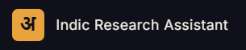

<div align="center">
  
</div>

<div align="center">


</div>

Indic Research Scholar helps students, researchers, and readers explore academic material in Indic languages. Upload a paper, ask grounded questions, and use speech input and spoken answers. The **Shorts Studio** turns a script into an editable explainer with generated scenes, narration, and a downloadable video with synchronized audio.

## Highlights

- **Document research:** upload supported papers, extract content with Sarvam OCR, and retrieve document-grounded answers using Pinecone.
- **Speech interaction:** transcribe spoken questions and return spoken answers using Sarvam speech services.
- **Shorts Studio:** create scenes from Markdown, PDF, or DOCX scripts; edit scene timing and visuals; select a narration language; generate synchronized MP4s; play, download, and delete Shorts.
- **Sarvam-powered narration:** Shorts scripts are prepared with Sarvam's `sarvam-105b` language model. Narration uses **`bulbul:v4-flash`** with language-compatible voices for English, Hindi, Tamil, Telugu, Kannada, Bengali, Marathi, and Gujarati. Malayalam currently uses `bulbul:v3`.
- **Language-specific exports:** generated narration is embedded in the selected-language MP4; the rendered timeline follows the generated audio duration.

## Architecture

| Component | Location | Purpose |
|---|---|---|
| React frontend | `indic_research_assistant_frontend/` | Research workspace, authentication UI, and Shorts Studio |
| Node.js API | `indic_research_assistant_backend/nodejs_service/` | Authentication, MongoDB data, Shorts orchestration, visuals, and FFmpeg rendering |
| Flask API | `indic_research_assistant_backend/flask_service/` | Sarvam LLM/TTS and document OCR, retrieval, and speech integrations |
| MongoDB | Local or hosted | User accounts and Shorts metadata |
| Pinecone | Hosted | Document embeddings and retrieval |

The browser calls the Node API on `http://localhost:3000`. Node calls Flask on `http://localhost:5000` for Shorts script and narration generation and for research integrations. Both backend services must use the same `INTERNAL_API_KEY`. The Flask and Node services must also share the same `SHORTS_STORAGE_PATH` so generated scene images, WAV audio, and MP4 files are accessible across the pipeline.

## Run locally

### Prerequisites

- Git
- Node.js 20 or newer and npm
- Python 3.10 or newer
- MongoDB Community Server or a MongoDB Atlas connection string
- Sarvam API key
- Pinecone API key and an existing Pinecone index for document research

Shorts rendering uses Playwright Chromium for scene visuals and the bundled `ffmpeg-static` package for MP4 composition.

### 1. Clone the repository

```bash
git clone https://github.com/YUGESHKARAN/indic_research_scholar.git
cd indic_research_scholar
```

### 2. Configure and start the Node.js API

```bash
cd indic_research_assistant_backend/nodejs_service
npm ci
npx playwright install chromium
```

Create `indic_research_assistant_backend/nodejs_service/.env`:

```dotenv
MONGO_URI=mongodb://127.0.0.1:27017/indic_research_scholar
JWT_SECRET=replace-with-a-long-random-secret
JWT_EXPIRES_IN=7d
NODE_ENV=development
CLIENT_ORIGIN=http://localhost:5173
INTERNAL_API_KEY=replace-with-a-shared-random-secret
FLASK_SERVICE_URL=http://localhost:5000
SHORTS_STORAGE_PATH=C:/absolute/path/to/indic_research_scholar/indic_research_assistant_backend/nodejs_service/public/videos
```

Use a real absolute local path for `SHORTS_STORAGE_PATH`; create its parent directory if needed. Copy the **same exact path** to the Flask `.env` in the next step. Keep secrets out of source control.

Start the API from the Node service directory:

```bash
npm run dev
```

The current server listens on port `3000`.

### 3. Configure and start the Flask API

Open another terminal:

```bash
cd indic_research_assistant_backend/flask_service
```

Create and activate a virtual environment:

```powershell
# Windows PowerShell
py -3 -m venv .venv
.\.venv\Scripts\Activate.ps1
```

```bash
# macOS / Linux
python3 -m venv .venv
source .venv/bin/activate
```

Install Python dependencies:

```bash
python -m pip install --upgrade pip
python -m pip install -r requirements.txt
```

Create `indic_research_assistant_backend/flask_service/.env`:

```dotenv
SARVAM_API_KEY=your-sarvam-api-key
PINECONE_API_KEY=your-pinecone-api-key
PINECONE_INDEX=your-existing-pinecone-index-name
NODE_BASE_URL=http://localhost:3000
NODE_INTERNAL_DOCS_PATH=/api/internal/docs
INTERNAL_API_KEY=replace-with-the-same-value-used-by-node
SHORTS_STORAGE_PATH=C:/absolute/path/to/indic_research_scholar/indic_research_assistant_backend/nodejs_service/public/videos
```

For Shorts-only development, the Sarvam API key and shared internal key are needed for script and voice generation. Pinecone credentials are also required by the current Flask app at startup and for document research.

Start Flask from its service directory:

```bash
python app.py
```

The Flask API listens on port `5000`.

### 4. Start the frontend

Open a third terminal:

```bash
cd indic_research_assistant_frontend
npm ci
npm run dev
```

Open the Vite URL shown in the terminal (normally `http://localhost:5173`). The frontend's current API client targets `http://localhost:3000`.

### Optional authentication integrations

- Email OTP and password-reset flows need SMTP settings in the Node `.env`: `EMAIL_PROVIDER`, `EMAIL_USER`, `EMAIL_PASS`, and `MAIL_USER`.
- GitHub login needs `GITHUB_CLIENT_ID`, `GITHUB_CLIENT_SECRET`, and `GITHUB_CALLBACK_URL`, with the callback registered in the GitHub OAuth app.

## Try Shorts Studio

1. Sign in to the workspace.
2. Open **Shorts Studio** and upload a `.md`, `.pdf`, or `.docx` script (up to 10 MB).
3. Review and edit the generated scenes and their durations.
4. Select a voice language and render. **Bulbul v4-flash** supplies the selected language's narration where supported.
5. Wait for the player to finish loading, then play or download the MP4. Its selected-language narration is embedded in the video.

Generated Shorts media is written beneath `SHORTS_STORAGE_PATH` into `scenes/`, `audio/`, and `final/`. The MongoDB record contains paths and metadata; it does not store the media bytes.

## Development checks

Frontend lint and production build:

```bash
cd indic_research_assistant_frontend
npm run lint
npm run build
```

Node Shorts tests:

```bash
cd indic_research_assistant_backend/nodejs_service
node --test test/script-parser.test.js test/video-composer.test.js test/shorts-render.test.js
```

Flask Shorts tests (with the Flask environment activated):

```bash
cd indic_research_assistant_backend/flask_service
python -m unittest discover -s tests -p "test_shorts_*.py"
```

## License

MIT — see [LICENSE](./LICENSE).
